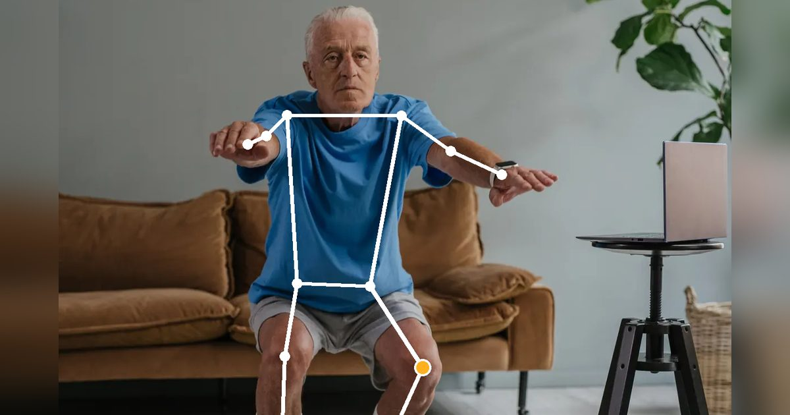
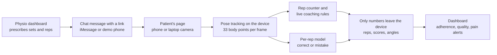
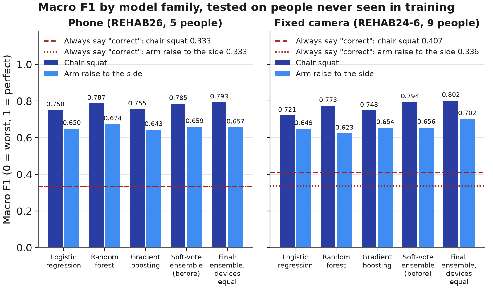
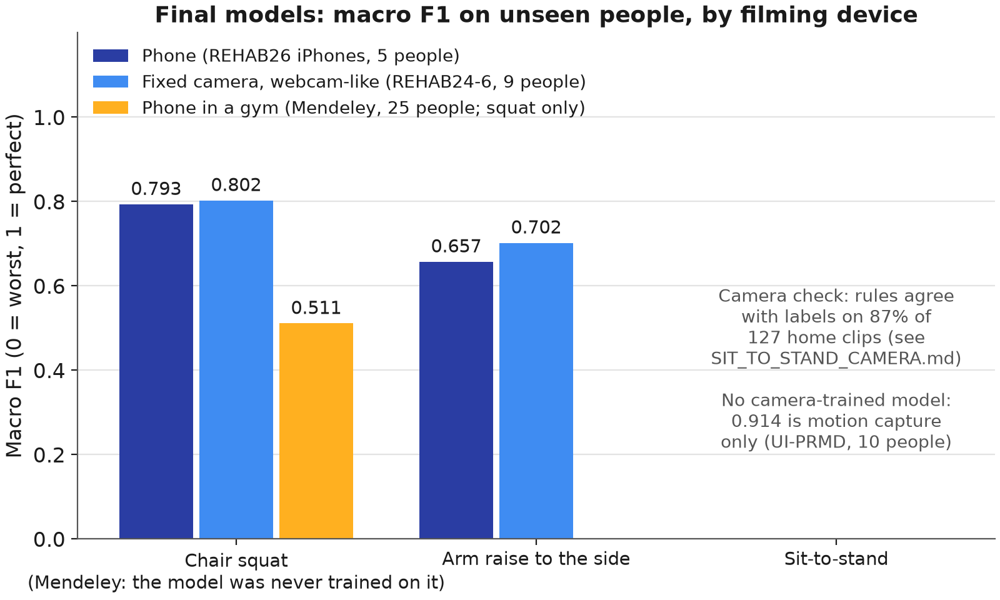
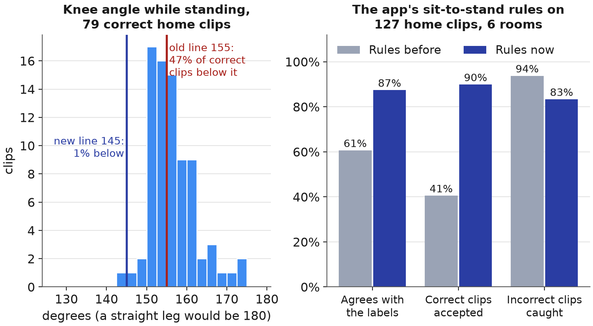
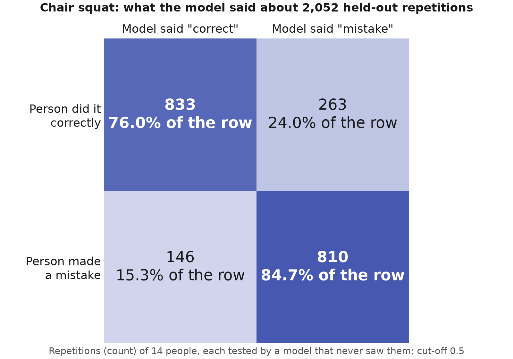
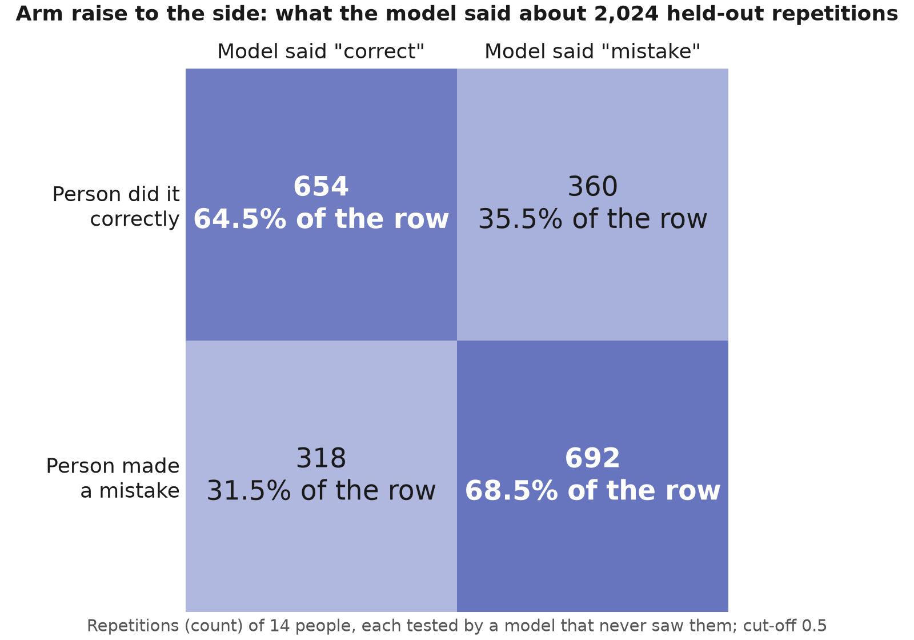
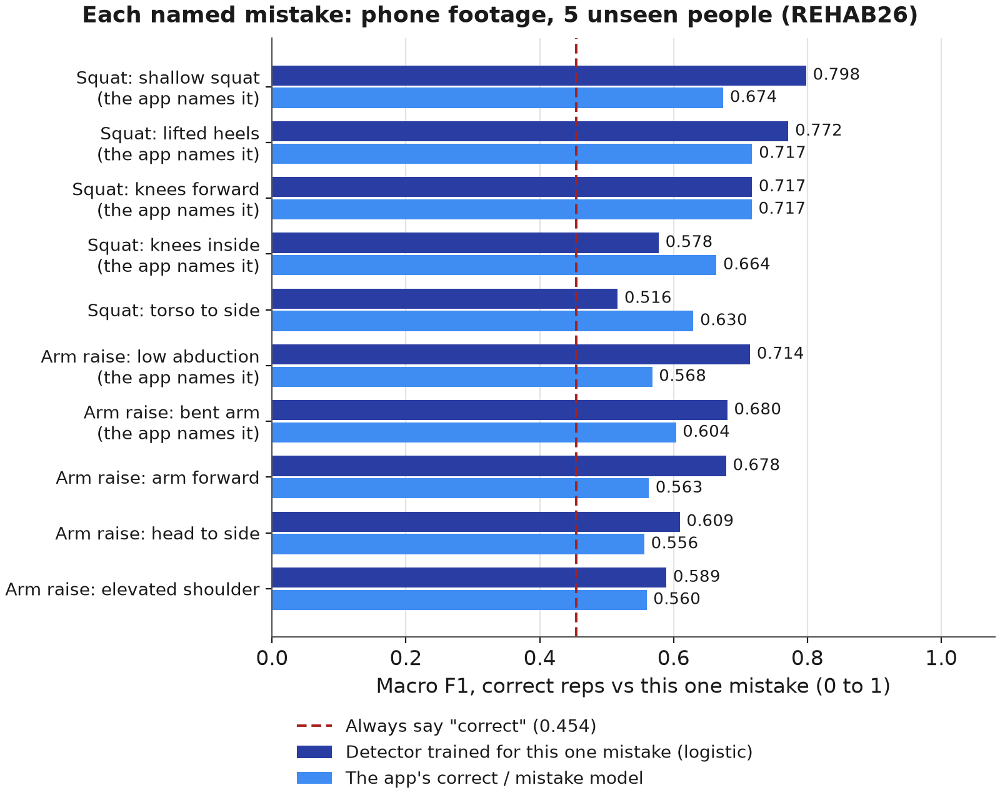
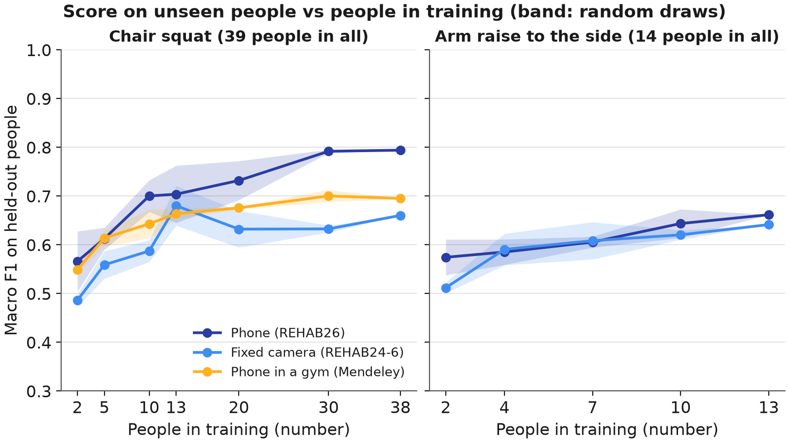
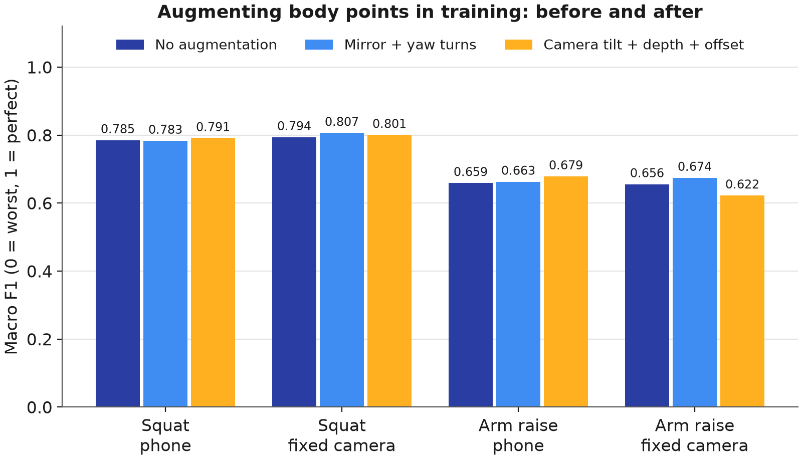

# jHealth

Home rehab, coached by the phone camera. A physiotherapist prescribes exercises; the patient opens a link from a chat message; the phone or laptop camera counts every repetition, coaches it out loud while it happens, and scores it; the physiotherapist sees who is doing the work and who is stalling.

Built for YHacks 2026 (Pillar 2, Healthcare). Live: **https://jhealth-beta.vercel.app**



*The points and lines are the output of our own pose pipeline on this photo.*

## How it fits together



The video never leaves the patient's device. Three jobs, three tools: **rules** coach in real time and name the mistake, a **trained model** scores each repetition, and an **AI coach** only writes chat messages (pain is handled by fixed rules, never the AI).

## The camera session

While the patient moves, the session draws the tracked skeleton, puts the measured angle on the joint, fills a gauge towards a goal, and talks:

| Exercise | Measured live | Goal | While moving | Mistakes named |
|---|---|---|---|---|
| Chair squat | Knee bend | 70° | "Lower, 25° to go" → "Good depth. Now stand up tall" | Knees caving in (live, knees turn red), too shallow, not standing up fully, too fast |
| Sit-to-stand | Knee bend | 75° | "Sit down slowly" → "Now stand up tall" | Knees caving in (live), not upright at the top, sitting down too fast |
| Arm raise to the side | Arm height | 80° | "Higher, 20° to go" → "Good height. Lower slowly" | Bent elbow (live), not up to shoulder height, body swaying, too fast |

After each repetition it says the count and either "Good rep, 87 out of 100" or the mistake. Before counting, it checks for half a second that the whole body is in frame (works on an iPhone in portrait and on a laptop webcam). Code: `web/src/lib/pose/live.ts` (live coaching), `exercises.ts` (rules after each rep), `reps.ts` (rep counter), `camera.ts` (camera check).

## The machine learning, step by step

Full tables, commands and caveats: [`docs/ML_RESULTS.md`](docs/ML_RESULTS.md). Everything below is measured, not estimated.

### 1. The question

For one repetition of one exercise: **was it done correctly, or with a mistake?** One small model per exercise answers with a probability.

### 2. The data

| Dataset | Filmed with | Exercises used | People | Labelled repetitions | Licence |
|---|---|---|---|---|---|
| [REHAB24-6](https://zenodo.org/records/13305826) | 2 fixed cameras (webcam-like) | squat, arm raise | 9 | 390 + 356 | CC BY-NC |
| [REHAB26-ViewAngles](https://zenodo.org/records/23018128) | 3 iPhones, front to side | squat, arm raise | 5 | 1,662 + 1,668 | CC BY-NC |
| [UI-PRMD](https://doi.org/10.5281/zenodo.23104965) | Vicon motion capture (lab) | sit-to-stand, squat, arm raise | 10 | 199 + 200 + 199 | public domain |
| [IntelliRehabDS](https://zenodo.org/records/4610859) | Kinect (lab), patients | arm raise | 28 | 522 | CC BY 4.0 |
| [WLU Rehabilitation Posture](https://www.kaggle.com/datasets/sulaimanmuhammed/wlu-rehabilitation-posture) | phones and webcams in people's homes | sit-to-stand (test only) | 6 rooms, nobody named | 127 clips | MIT |

Camera data today: **4,076 labelled repetitions from 14 people**. Each repetition was marked correct or incorrect by the dataset's authors (in REHAB24-6, under a physiotherapist's instruction). The number that limits us is people, not repetitions: the model is always tested on a person it has never seen.

In progress: 150 phone-filmed squat clips from 26 more people ([Mendeley Data, CC BY 4.0](https://doi.org/10.17632/kgbb3yn47p.3)), fetched by `ml/fetch_mendeley_squats.py`.

### 3. From video to numbers

1. **Track.** MediaPipe Pose (heavy model) gives 33 body points in 3D for every frame, in the browser and in training alike.
2. **Cut into repetitions.** A repetition is one dip of the working joint's angle. The same cutter runs live in the app; fed frame by frame through the public squat videos it found 193 of the physiotherapist's 195 hand-marked repetitions, with no false ones.
3. **Describe each repetition.** It is resampled to 64 frames and turned into angle signals: 17 for a leg exercise (knee and hip angles, left-right differences, trunk lean, pelvis tilt, knee gap, ankle gap, hip height...), 12 for an arm exercise.
4. **Summarise each signal with 11 statistics** (min, max, range, mean, spread, when the min and max happen, speed, peak speed, jerk, first half vs second half), plus the duration: **188 numbers per squat, 133 per arm raise.**
5. **Classify.** The model reads those numbers and returns the probability of a mistake.

The browser computes the same numbers as the Python training code to six decimal places (`web/scripts/pose.test.ts`), so the patient's device runs exactly the model that was tested.

### 4. How every number is tested

**Leave one person out.** All repetitions of one person, from every camera, are hidden; the model is trained on everyone else and scored on the hidden person; repeated for every person. A real patient is always someone new, so this is the test that predicts real use.

Why it matters: in our first study the same model scored 0.83 to 0.90 when repetitions were split at random (the same people in training and test), and 0.59 to 0.75 tested honestly. We report only the honest number. Metric: macro F1 (1.0 is perfect; always answering "correct" scores about 0.33 to 0.41).

### 5. Models compared

Logistic regression, random forest, gradient boosting, and a soft vote of the three, each with and without class weights and device weights: 16 configurations per exercise.



No single family wins on both devices. The soft-vote ensemble is the steadiest, and weighting phone and fixed-camera data equally matches how patients will film (about half on a phone, half on a laptop). That is the model in the app.

### 6. Results by filming device



| Exercise | Device | People / reps | Macro F1 | AUC | When it says "mistake": precision / recall |
|---|---|---|---|---|---|
| Chair squat | phone | 5 / 1,662 | 0.793 | 0.881 | 0.760 / 0.862 |
| Chair squat | fixed camera | 9 / 390 | 0.802 | 0.887 | 0.717 / 0.746 |
| Arm raise | phone | 5 / 1,668 | 0.657 | 0.716 | 0.653 / 0.671 |
| Arm raise | fixed camera | 9 / 356 | 0.702 | 0.784 | 0.680 / 0.750 |
| Sit-to-stand | motion capture only | 10 / 199 | 0.914 | 0.978 | 0.880 / 0.960 |

**Sit-to-stand on camera.** No public dataset has camera sit-to-stand repetitions with technique mistakes labelled, and the motion-capture model does not survive the move to a camera (AUC 0.54 on real home video). What does exist is 127 home clips labelled as a valid repetition or not (WLU). On those, the app's sit-to-stand check agrees with the labels on **87%** of clips (macro F1 0.87, 90% of correct clips accepted). Before this test it agreed on 61%: the "stand up tall" rule expected a knee angle that a single camera never measures, so it objected to almost half of the correct clips. The same rule was wrong on 17% of correct phone squats. Both are fixed. The squat model, used as the stand-in for sit-to-stand, scores a typical correct home repetition 85 out of 100 and flags none of them. Details: [docs/SIT_TO_STAND_CAMERA.md](docs/SIT_TO_STAND_CAMERA.md).



Where the models err:




### 7. Which mistakes can a camera see?

REHAB26 names the mistake in every repetition, so each one can be tested alone:



A shallow squat, lifted heels and knees going forward are caught well; a hitched shoulder or a tilted head are near guessing from body points. Scored only against the mistakes the app actually names out loud, the squat reaches 0.81 to 0.83 and the arm raise 0.65 to 0.76 (phone footage, 5 people; a secondary number, not the headline).

### 8. Would more recorded people raise the score?



Yes. Trained on 2 people the squat scores 0.61; on 13 people 0.79, and the curve has not flattened. This is why the next round adds 26 more people, and why the team's own clips matter (`docs/RECORDING.md`).

### 9. What did not help



- **Mirroring and turning the body:** no effect by construction, because the features are angles measured relative to the body.
- **Camera tilt and depth augmentation:** within noise for the squat, worse for the arm raise on a fixed camera.
- **Bigger or different models, class weights:** differences of about 0.01.
- **Earlier rounds:** per-person calibration, 2D image angles, lab data mixed into camera training, each dataset on its own scale.

Model tweaks move the score by hundredths. Data moves it by tenths.

### 10. When the app flags a repetition

The app only says "that one was off" when the model is confident. On phone footage about 9 in 10 such flags are real mistakes (squat: precision 0.92, catching 59%). On the fixed camera this does **not** hold yet (about 7 in 10), so the rules, not the model, carry the feedback there.

### Rules and model together

A rules-only squat corrector (angle thresholds per frame) gives instant feedback but has no measurable accuracy and no notion of an unseen person. jHealth uses rules for what must be instant and explainable (depth, knees, elbow), and a tested model for the overall quality score. The rules are measured too: on 127 home sit-to-stand clips they were wrong more often than we thought, and two of them were corrected ([docs/SIT_TO_STAND_CAMERA.md](docs/SIT_TO_STAND_CAMERA.md)).

## Honest limits

- **People.** The models learn from 14 people on camera, healthy adults in labs, not older patients at home. Only the sit-to-stand check has been tested on ordinary home video.
- **0.9 is not reached on camera.** It is reached on lab motion capture (sit-to-stand 0.91, arm raise 0.97). The route on camera is more labelled people.
- **A webcam is a stand-in.** REHAB24-6's fixed cameras stand in for a laptop webcam; no labelled laptop recordings exist yet.
- **Angles from one camera are a trend, not a clinical measurement.**
- **Licences.** REHAB24-6 and REHAB26 are CC BY-NC: research and prototype use only.
- **jHealth does not diagnose or change the plan.** The physiotherapist prescribes; jHealth coaches, measures and reports.

## The rest of the product

- **Chat.** Patients text jHealth in iMessage (a small bridge on a Mac, `web/scripts/imessage-bridge.mjs`), or use the demo phone, a chat page on the site with the same coach and rules. Pain of 7/10 or a red flag stops the plan, sends a fixed safety reply and alerts the physio.
- **Dashboard.** Patients, plans, sessions, alerts, the chat thread. Sign-in with a signed session cookie.
- **Security.** Tested with 51 scripted attacks (`web/scripts/attack.sh`); the database is locked to the server. See [`docs/SECURITY.md`](docs/SECURITY.md).
- **Hosting.** Next.js on Vercel (Montreal), Postgres on Supabase (Canada).

More: [`docs/SYSTEM_DESIGN.md`](docs/SYSTEM_DESIGN.md), [`docs/HOW_WE_BUILT_IT.md`](docs/HOW_WE_BUILT_IT.md), [`docs/PROJECT_NOTES.md`](docs/PROJECT_NOTES.md) (older, longer notes; parts describe earlier versions).

## Run it

```bash
cd web && npm install
```

```bash
cd web && npm run dev
```

Then open http://localhost:3100. Without a database address the app runs a real Postgres inside itself (PGlite).

| Check | Command (from `web/`) |
|---|---|
| 60 unit tests: rep counter, live coaching, browser/Python parity, pain rule, access rules | `npm run test:unit` |
| 54 database rules | `npm run db:verify` |
| 51 attacks from outside | `bash scripts/attack.sh` |
| Reproduce the training round (from `ml/`) | see the end of [`docs/ML_RESULTS.md`](docs/ML_RESULTS.md) |

## Repository map

| Folder | What is in it |
|---|---|
| `web/` | The app: dashboard, patient pages, camera session, chat channels, API |
| `ml/` | Dataset converters, feature code, training and evaluation scripts, exported models |
| `supabase/` | Database migrations and demo data |
| `docs/` | ML results and charts, security, system design, recording guide |
