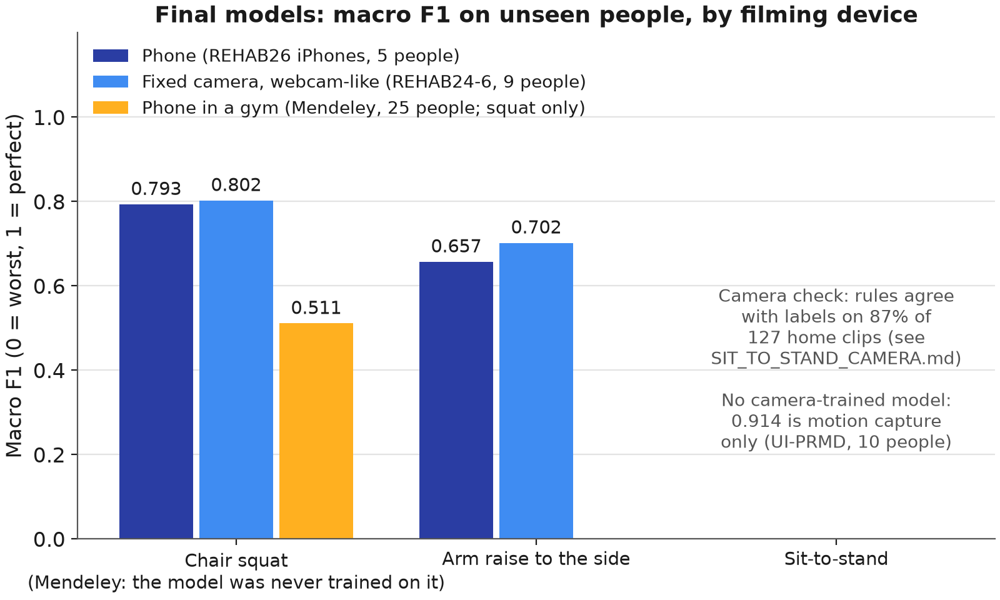
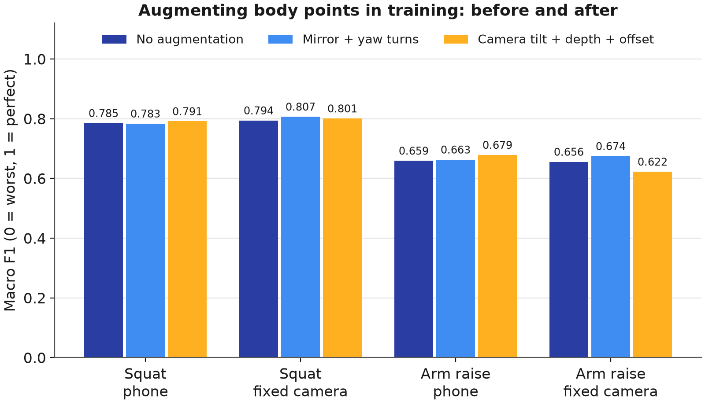
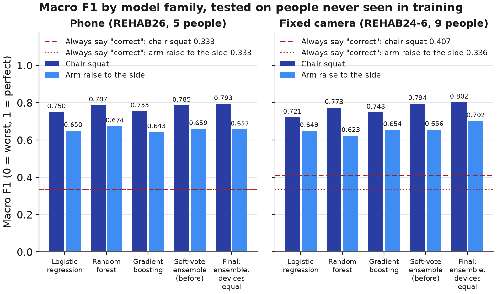
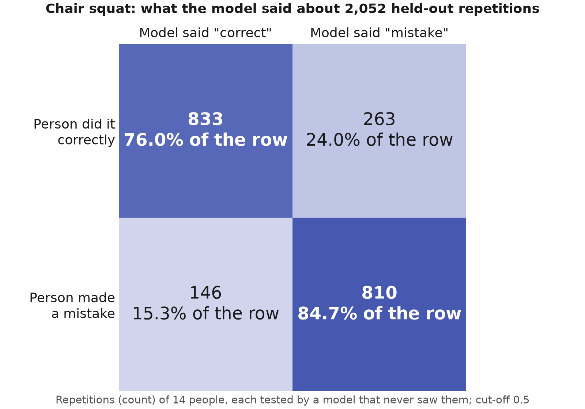
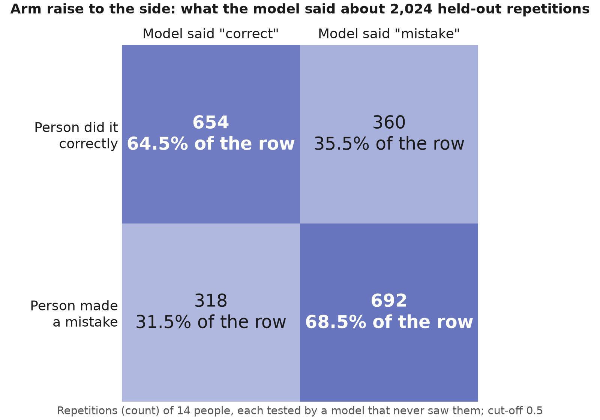
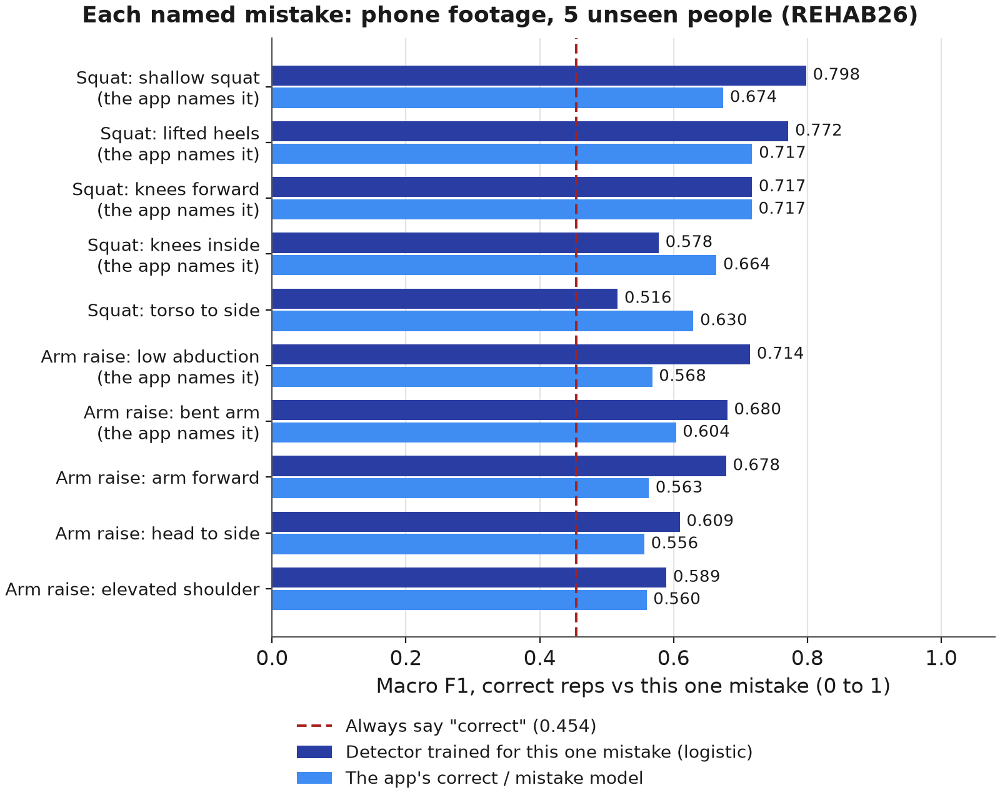
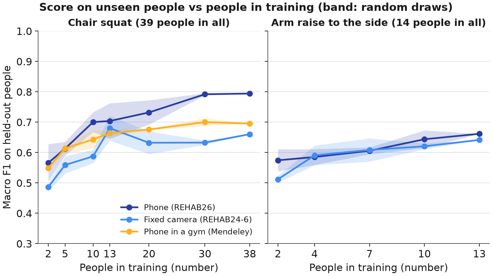
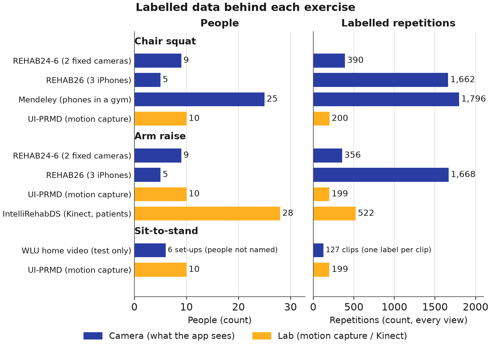

# ML results: final training round (19 November 2026)

Per-repetition "correct vs mistake" models for chair squat, arm raise to the side and sit-to-stand. Sections 1 to 10 were measured by `ml/final_round.py` and section 11 by `ml/mendeley_squat.py`; this file is written by `ml/final_round_report.py` from their output, so those numbers are not retyped. The sit-to-stand camera test in section 1 is the exception: it is quoted from [SIT_TO_STAND_CAMERA.md](SIT_TO_STAND_CAMERA.md).

**How every number is tested.** Leave one person out: all repetitions of the hidden person, from every camera and view, are removed from training; the model is trained on everyone else and scored on the hidden person; repeated for each person. Settings are fixed in the script or chosen inside the training people only. Features are unchanged (the browser computes the same ones). Macro F1 uses the cut-off 0.5. "Precision" and "recall" are for the mistake class: of the reps called a mistake, the share that were one; of the real mistakes, the share that were caught.

**Device groups.** *Phone* = REHAB26-ViewAngles (three iPhones, front to profile). *Fixed camera (webcam-like)* = REHAB24-6 (two fixed cameras). For squat and arm raise no labelled laptop-webcam recordings exist; REHAB24-6 is the stand-in.

## 1. Before and after

Before = the models in the app until today (soft-vote ensemble of logistic regression, random forest and gradient boosting, trained on both camera datasets). After = the same ensemble, with the two device groups weighted equally in training (`ensemble | balanced + devices weighted equally`). Both exported models were replaced (section 9).

| Exercise | Device group (dataset) | People | Reps | Macro F1 before | Macro F1 after | AUC before | AUC after | Precision / recall before | Precision / recall after | Always "correct" floor |
|---|---|---|---|---|---|---|---|---|---|---|
| Chair squat | phone (REHAB26-ViewAngles, 3 iPhones) | 5 | 1662 (834 mistakes) | 0.785 | **0.793** | 0.878 | 0.881 | 0.744 / 0.878 | 0.760 / 0.862 | 0.333 |
| Chair squat | fixed camera (webcam-like) (REHAB24-6, 2 fixed cameras) | 9 | 390 (122 mistakes) | 0.794 | **0.802** | 0.874 | 0.887 | 0.703 / 0.738 | 0.717 / 0.746 | 0.407 |
| Arm raise to the side | phone (REHAB26-ViewAngles, 3 iPhones) | 5 | 1668 (834 mistakes) | 0.659 | **0.657** | 0.733 | 0.716 | 0.650 / 0.692 | 0.653 / 0.671 | 0.333 |
| Arm raise to the side | fixed camera (webcam-like) (REHAB24-6, 2 fixed cameras) | 9 | 356 (176 mistakes) | 0.656 | **0.702** | 0.741 | 0.784 | 0.624 / 0.784 | 0.680 / 0.750 | 0.336 |

**Sit-to-stand** has no camera-trained model, but since the evening of 19 November it has a camera test. Detail and method: [SIT_TO_STAND_CAMERA.md](SIT_TO_STAND_CAMERA.md) (measured by the main session with `ml/wlu_sit_to_stand.py`; not re-run by `final_round.py`). In short:

- **Data:** WLU Rehabilitation Posture (Kaggle, MIT licence): 127 home clips (79 correct, 48 incorrect), phones and webcams, 6 recording set-ups (nobody is named; clips are grouped by room). The labels mean "a valid repetition or not" (mostly unfinished movements), not fine technique mistakes.
- **The app's sit-to-stand rules** agree with the labels on 87% of clips (macro F1 0.87; 90% of correct clips accepted, 83% of incorrect ones caught). Before the fix: 61%, macro F1 0.60, 41% of correct clips accepted. With settings picked without the tested set-up: 89%, macro F1 0.88.
- **What was fixed:** the "stand up tall" line was 155 degrees, but a standing knee measures a median of 155 on camera; it is now 145 (`UPRIGHT_KNEE`). At 155 it also objected to 17% of correct REHAB26 phone squats and 7% of REHAB24-6 ones (4% and 0% at 145). "Knees out" is now judged only when the person faces the camera (`FACING_MIN` 0.6).
- **Trained models on 50 real stand-sit-stand repetitions** (42 correct, 8 incorrect): the squat model used as the stand-in has AUC 0.84 and flags 0% of the correct ones; the UI-PRMD motion-capture model has AUC 0.54 (0.68 after camera calibration on the other set-ups).
- **So the motion-capture score stays a lab-only number:** UI-PRMD, 10 people, 199 repetitions (99 with a mistake), logistic regression, re-measured in this round from the cached body points: macro F1 0.914, AUC 0.978, precision 0.880, recall 0.960. The number stored with `sit_to_stand.json` on 18 November is macro F1 0.904, AUC 0.978; the difference is 2 of 199 repetitions and was not tracked down. `sit_to_stand.json` was not changed.



How to read the change, honestly:

- Arm raise on the fixed camera is the only clear gain: macro F1 +0.046, AUC +0.042. On phones macro F1 moved -0.002 (inside the 0.01 tolerance) but AUC moved -0.017, a small loss.
- Squat moved +0.008 (phone) and +0.008 (fixed camera). With 5 and 9 people that is within noise: treat the squat as unchanged at about 0.79 to 0.80.
- Chair squat, fixed camera: better for 4 of 9 people, worse for 2.
- Chair squat, phone: better for 3 of 5 people, worse for 2.
- Arm raise to the side, fixed camera: better for 6 of 9 people, worse for 3.
- Arm raise to the side, phone: better for 3 of 5 people, worse for 2.
- **Selection check.** About 28 configurations were scored on the same held-out people, and the "after" one was chosen after seeing them, which flatters it. Re-using the stored predictions, the configuration for each person was picked without that person (best weaker-device macro F1 on the other 13). That gives chair squat 0.769 phone / 0.796 fixed camera; arm raise to the side 0.652 phone / 0.651 fixed camera. So the honest reading is: this round did not move the scores beyond noise, except possibly arm raise on the fixed camera.

## 2. The data behind each number

| Exercise | Dataset | Device group | People | Repetitions | With a mistake |
|---|---|---|---|---|---|
| Chair squat | REHAB24-6, 2 fixed cameras | fixed camera (webcam-like) | 9 | 390 | 122 |
| Chair squat | REHAB26-ViewAngles, 3 iPhones | phone | 5 | 1662 | 834 |
| Chair squat | Mendeley multi-view fitness (section 11) | phone (Mendeley, gym) | 25 | 1796 | 916 (labelled per clip) |
| Arm raise to the side | REHAB24-6, 2 fixed cameras | fixed camera (webcam-like) | 9 | 356 | 176 |
| Arm raise to the side | REHAB26-ViewAngles, 3 iPhones | phone | 5 | 1668 | 834 |
| Sit-to-stand | UI-PRMD sit-to-stand | lab (motion capture / Kinect), not a camera | 10 | 199 | 99 |
| Chair squat | UI-PRMD deep squat | lab (motion capture / Kinect), not a camera | 10 | 200 | 100 |
| Arm raise to the side | UI-PRMD shoulder abduction | lab (motion capture / Kinect), not a camera | 10 | 199 | 99 |
| Arm raise to the side | IRDS abduction (patients) | lab (motion capture / Kinect), not a camera | 28 | 522 | 83 |
| Sit-to-stand | WLU Rehabilitation Posture (see SIT_TO_STAND_CAMERA.md) | home phones and webcams; used to test, not to train | 6 recording set-ups (people not named) | 127 clips | 48 clips |

A REHAB26 repetition filmed by three iPhones counts as three repetitions (three views); REHAB24-6 likewise has two cameras per repetition. All views of a hidden person are hidden together. The README says REHAB24-6 has 10 people; the squat and arm-abduction repetitions on disk come from 9.

Lab datasets, each tested on its own unseen people (two fixed model families, no picking):

| Dataset | People | Reps | Logistic: macro F1 | AUC | Precision / recall | Logistic + forest: macro F1 | AUC | Precision / recall |
|---|---|---|---|---|---|---|---|---|
| UI-PRMD sit-to-stand | 10 | 199 | 0.914 | 0.978 | 0.880 / 0.960 | 0.899 | 0.970 | 0.850 / 0.970 |
| UI-PRMD deep squat | 10 | 200 | 0.800 | 0.904 | 0.783 / 0.830 | 0.815 | 0.894 | 0.789 / 0.860 |
| UI-PRMD shoulder abduction | 10 | 199 | 0.970 | 0.994 | 0.989 / 0.949 | 0.980 | 0.996 | 0.990 / 0.970 |
| IRDS abduction (patients) | 28 | 522 | 0.776 | 0.942 | 0.582 / 0.687 | 0.791 | 0.952 | 0.620 / 0.687 |

The README's 0.83 (UI-PRMD squat) and 0.82 (IntelliRehabDS) were the best of several models and training mixes in `train_exercise.py`; the two fixed families here give the numbers above. The README counts 29 IntelliRehabDS people; the abduction repetitions on disk come from 28.

## 3. Experiment b: augmenting the body points before feature extraction (training people only)

| Training data (same ensemble) | Chair squat: phone | Chair squat: fixed camera | Arm raise to the side: phone | Arm raise to the side: fixed camera |
|---|---|---|---|---|
| No augmentation (baseline) | 0.785 | 0.794 | 0.659 | 0.656 |
| Mirror + yaw turn of -30, -15, 15 or 30 degrees (each rep x3) | 0.783 | 0.807 | 0.663 | 0.674 |
| Control: each rep simply repeated x3, no augmentation | 0.787 | 0.805 | 0.663 | 0.671 |
| Camera tilt (pitch +-10, roll +-6 degrees) + depth x0.8 to x1.25 + 2% body-point offset (each rep x3) | 0.791 | 0.801 | 0.679 | 0.622 |

- **Mirroring and yaw turns cannot help, by construction.** The features are joint angles, distances and directions measured relative to the body and to "down", so turning the body around the vertical axis or mirroring it leaves them unchanged. Measured: mirroring changes no feature at all; a yaw turn moves 0.0005% (squat) and 0.0011% (arm raise) of feature values, all of them "when is the minimum / maximum" ties.
- The small changes in the mirror + yaw row are therefore from seeing each repetition three times (which loosens the models' regularisation), not from new views: the control row reproduces them.
- **Camera tilt + depth + offset** is a real change to the features. Squat: within noise. Arm raise: better on phones, worse on the fixed camera. Not adopted.



## 4. Experiment c: model families and class weights

Macro F1 (AUC in brackets), unseen people.

| Model | Weights | Chair squat: phone | Chair squat: fixed camera | Arm raise to the side: phone | Arm raise to the side: fixed camera |
|---|---|---|---|---|---|
| Logistic regression, C = 0.1 | classes balanced | 0.756 (0.870) | 0.768 (0.869) | 0.637 (0.698) | 0.630 (0.699) |
| Logistic regression, C chosen inside the training people (grid 0.01 to 1) | classes balanced | 0.750 (0.871) | 0.721 (0.845) | 0.650 (0.708) | 0.649 (0.713) |
| Random forest (300 trees) | classes balanced | 0.787 (0.867) | 0.773 (0.857) | 0.674 (0.743) | 0.623 (0.702) |
| Gradient boosting (200 rounds, depth 3) | classes balanced | 0.755 (0.852) | 0.748 (0.830) | 0.643 (0.702) | 0.654 (0.723) |
| Soft vote: logistic C = 0.1 + forest + boosting | classes balanced | 0.785 (0.878) | 0.794 (0.874) | 0.659 (0.733) | 0.656 (0.741) |
| Soft vote with the nested-C logistic | classes balanced | 0.782 (0.878) | 0.783 (0.866) | 0.668 (0.741) | 0.668 (0.748) |
| Logistic regression, C = 0.1 | no class weights | 0.766 (0.870) | 0.775 (0.869) | 0.637 (0.698) | 0.635 (0.699) |
| Logistic regression, C chosen inside the training people (grid 0.01 to 1) | no class weights | 0.769 (0.875) | 0.718 (0.840) | 0.650 (0.708) | 0.652 (0.713) |
| Random forest (300 trees) | no class weights | 0.784 (0.861) | 0.786 (0.856) | 0.673 (0.743) | 0.608 (0.710) |
| Gradient boosting (200 rounds, depth 3) | no class weights | 0.761 (0.852) | 0.763 (0.833) | 0.636 (0.704) | 0.663 (0.718) |
| Soft vote: logistic C = 0.1 + forest + boosting | no class weights | 0.788 (0.877) | 0.787 (0.875) | 0.661 (0.734) | 0.659 (0.743) |
| Soft vote with the nested-C logistic | no class weights | 0.790 (0.878) | 0.761 (0.863) | 0.662 (0.742) | 0.668 (0.748) |
| Logistic regression, C = 0.1 | classes balanced + devices weighted equally | 0.762 (0.869) | 0.790 (0.892) | 0.616 (0.664) | 0.674 (0.735) |
| Random forest (300 trees) | classes balanced + devices weighted equally | 0.793 (0.862) | 0.793 (0.876) | 0.688 (0.744) | 0.663 (0.748) |
| Gradient boosting (200 rounds, depth 3) | classes balanced + devices weighted equally | 0.780 (0.864) | 0.728 (0.825) | 0.618 (0.687) | 0.705 (0.769) |
| Soft vote: logistic C = 0.1 + forest + boosting | classes balanced + devices weighted equally | 0.793 (0.881) | 0.802 (0.887) | 0.657 (0.716) | 0.702 (0.784) |

- No family wins everywhere. The forest is best on phones and weakest on the fixed camera for the arm raise; the soft-vote ensemble is the steadiest across both devices, so it stays.
- Class weights (balanced or none) change macro F1 by about 0.01 or less in the ensemble.
- Weighting the two device groups equally (REHAB26 has about four times as many repetitions, from fewer people) is the one setting that matches "half phone, half webcam" use, and it is what was exported.
- Chosen C per hidden person (nested logistic, balanced): squat [0.01, 0.03, 0.1], arm raise [0.3, 1.0].







## 5. Experiment d (secondary metric): "coachable" mistakes only

**This is not the main number.** It asks a narrower question: correct repetitions against only the mistakes the app names out loud. Only REHAB26 names the mistake of each repetition, so this is phone footage, 5 people. Squat: too shallow, knees inside, lifted heels, knees forward. Arm raise: arm too low (low abduction), bent arm. "Body swaying" has no label in REHAB26's arm raise, so it is not in the score.

| Exercise | Model | People | Reps | Macro F1 | AUC | Precision | Recall |
|---|---|---|---|---|---|---|---|
| Chair squat | The app's model (trained on all mistakes), other mistakes left out of the test | 5 | 1497 (669 mistakes) | 0.806 | 0.906 | 0.727 | 0.906 |
| Chair squat | Same ensemble trained without REHAB26's other mistakes | 5 | 1497 (669 mistakes) | 0.831 | 0.917 | 0.760 | 0.909 |
| Arm raise to the side | The app's model (trained on all mistakes), other mistakes left out of the test | 5 | 1167 (333 mistakes) | 0.645 | 0.754 | 0.449 | 0.730 |
| Arm raise to the side | Same ensemble trained without REHAB26's other mistakes | 5 | 1167 (333 mistakes) | 0.758 | 0.838 | 0.632 | 0.691 |

Each named mistake against correct repetitions (macro F1; 5 people; about 830 correct and 165 to 168 mistake rep-views each):

| Exercise | Mistake | App names it | Mistake reps | Detector for this one mistake (logistic) | The app's model | Share of these reps the app's model flags (cut-off 0.5) |
|---|---|---|---|---|---|---|
| Chair squat | shallow squat | yes | 168 | 0.798 | 0.674 | 0.833 |
| Chair squat | lifted heels | yes | 168 | 0.772 | 0.717 | 0.994 |
| Chair squat | knees forward | yes | 165 | 0.717 | 0.717 | 1.000 |
| Chair squat | knees inside | yes | 168 | 0.578 | 0.664 | 0.798 |
| Chair squat | torso to side | no | 165 | 0.516 | 0.630 | 0.685 |
| Arm raise to the side | low abduction | yes | 165 | 0.714 | 0.568 | 0.667 |
| Arm raise to the side | bent arm | yes | 168 | 0.680 | 0.604 | 0.792 |
| Arm raise to the side | arm forward | no | 168 | 0.678 | 0.563 | 0.643 |
| Arm raise to the side | head to side | no | 168 | 0.609 | 0.556 | 0.619 |
| Arm raise to the side | elevated shoulder | no | 165 | 0.589 | 0.560 | 0.636 |

The per-mistake detector is the logistic model of `mistake_check.py`. The README's per-mistake numbers (0.86 for a shallow squat, and so on) are that script's other column, the one-number rule; it was not re-run in this round.



## 6. Experiment e: would more recorded people raise the score?

Hidden person as always; training people drawn at random from the other 13 (4 draws per size; ± is the spread over draws). Model: soft vote of logistic (C=0.1) + forest (100 trees), balanced (a lighter stand-in for the exported ensemble, to fit the time budget; boosting left out).

| People in training | Reps in training (squat, average) | Chair squat: all reps pooled | Chair squat: phone | Chair squat: fixed camera | Arm raise to the side: all reps pooled | Arm raise to the side: phone | Arm raise to the side: fixed camera |
|---|---|---|---|---|---|---|---|
| 2 | 293 | 0.608 ± 0.025 | 0.599 ± 0.027 | 0.610 ± 0.040 | 0.566 ± 0.032 | 0.574 ± 0.037 | 0.512 ± 0.011 |
| 4 | 612 | 0.698 ± 0.017 | 0.704 ± 0.035 | 0.630 ± 0.065 | 0.592 ± 0.022 | 0.585 ± 0.026 | 0.591 ± 0.032 |
| 7 | 1040 | 0.709 ± 0.037 | 0.699 ± 0.047 | 0.675 ± 0.023 | 0.607 ± 0.010 | 0.606 ± 0.011 | 0.608 ± 0.038 |
| 10 | 1463 | 0.769 ± 0.030 | 0.756 ± 0.039 | 0.777 ± 0.007 | 0.641 ± 0.026 | 0.644 ± 0.029 | 0.620 ± 0.010 |
| 13 | 1905 | 0.786 | 0.778 | 0.786 | 0.659 | 0.662 | 0.642 |

**Yes: the curves are still rising at 13 people** for both exercises, and have not flattened. Recording more people (especially on the devices patients use) is the most likely way to raise the score. The curve cannot say how far it goes. A phone person brings about 330 rep-views and a fixed-camera person about 40, so "people" also means more repetitions.



The squat panel of this chart uses the larger pool of people of section 11 (REHAB24-6 + REHAB26 + Mendeley); the table above is the REHAB-only curve.

## 7. Experiment f: when the app says "mistake", how often is it right?

The lowest cut-off at which at least 90% of flagged held-out repetitions are real mistakes (as `operating_point.py`). The cut-off is chosen on the same held-out predictions it is scored on, so the last columns repeat the rule with the cut-off chosen without the tested person.

| Exercise (final model) | Cut-off | All held-out reps: precision / recall | Phone | Fixed camera | Cut-off chosen without the tested person |
|---|---|---|---|---|---|
| Chair squat | 0.84 | 0.902 / 0.542 (574 flags) | 0.916 / 0.591 (538 flags) | 0.694 / 0.205 (36 flags) | 0.732 / 0.240 (313 flags; no cut-off reached 90% for 2 of 14 people, who get no flags) |
| Arm raise to the side | 0.79 | 0.913 / 0.187 (207 flags) | 0.930 / 0.159 (143 flags) | 0.875 / 0.318 (64 flags) | 0.888 / 0.196 (223 flags) |

- Squat: on phone footage about 9 in 10 flags are real and about 6 in 10 mistakes are caught. **On the fixed camera this does not hold**: few repetitions are flagged and about 7 in 10 flags are real. With the cut-off chosen without the tested person, precision is about 0.73 overall. Do not claim "9 in 10" for webcams.
- Arm raise: precision at the cut-off is 0.930 on phones and 0.875 on the fixed camera, but fewer than 1 in 5 mistakes is flagged overall.
- Before this round the same table read: squat cut-off 0.85, precision / recall 0.901 / 0.545 overall, 0.911 / 0.612 phone, 0.611 / 0.090 fixed camera (18 flags); arm raise cut-off 0.82, 0.923 / 0.165 overall, 0.922 / 0.169 phone, 0.929 / 0.148 fixed camera (28 flags).

## 8. What helped, what did not

| Tried | Result | Kept |
|---|---|---|
| Devices weighted equally in training | Arm raise fixed camera up (0.656 to 0.702); squat and arm raise phone within noise | yes |
| Mirroring, yaw turns | No effect by construction (features do not change) | no |
| Camera tilt / depth / offset augmentation | Squat within noise; arm raise phone up, fixed camera down | no |
| Logistic with C chosen in training folds | Lower on squat fixed camera (0.768 to 0.721); +0.013 and +0.019 on arm raise as a single model, +0.009 and +0.012 inside the ensemble | no |
| Random forest or gradient boosting alone | Neither beats the ensemble on both devices | no |
| No class weights | About 0.01 or less either way | no |
| Earlier rounds (not repeated) | Per-person calibration, 2D image-plane angles, lab data in camera training for arms, each dataset on its own scale: all dropped | no |

## 9. Files and model replacement

- `ml/models/squat.json`, `ml/models/arm_raise.json` and the copies in `web/public/models/` were replaced with the device-weighted ensembles (same format, same features; flag cut-offs 0.84 and 0.79). Old files: `~/jhealth-cache/models-backup-20261119/`. `ml/models/parity_squat.json` and `parity_arm_raise.json` were regenerated; `node --test scripts/pose.test.ts` passed (4 of 4) before and after.
- To go back: copy the two JSON files from the backup's `ml-models/` into `ml/models/` and `web/public/models/`, and the two parity files into `ml/models/`.
- `ml/operating_point.py` would recompute the cut-off without the device weights; use `final_round.py export` instead for these two models.

## 10. Not verified

- Whether any person appears in both REHAB24-6 and REHAB26 (same research group; ids are numbers in one and first names in the other). If someone does, that person leaks between training and test.
- A real laptop webcam and a real propped-up phone at home: both device groups are lab recordings of healthy adults.
- Which MediaPipe model produced REHAB26's body points (they come from the dataset authors); REHAB24-6 uses the heavy tracker.
- The app in a browser was not run; only the parity test (same features and score as Python on one repetition per exercise).
- The sit-to-stand camera numbers in section 1 (WLU): quoted from SIT_TO_STAND_CAMERA.md, not re-run here.

## 11. New squat data: Mendeley multi-view fitness dataset (added 19 November, evening)

"A Multi-View Raw Video Dataset of Seven Fitness Exercises with Good/Bad Form Labels" (Mendeley Data, DOI 10.17632/kgbb3yn47p.3, CC BY 4.0): people filmed on smartphones in a gym, bodyweight squats, front / side / diagonal views, about 31 s per clip at 15 frames per second, faces blurred. **One label per clip** (good or bad form); the dataset page does not say which mistakes make a clip bad. Every repetition inherits its clip's label, so some repetitions inside a "bad" clip may be fine. Script: `ml/mendeley_squat.py`.

**Tracking and cutting.** Same tracker and settings as the REHAB24-6 body points the squat model is trained on (MediaPipe heavy model, video mode, one person, 15 frames per second). Repetitions are cut by the project's own cutter (`extract_clips.find_reps`, squat settings). A clip is used when the person is found in at least 60% of frames; a repetition is dropped when the tracker lost the person in more than 20% of it or drew the body upside down (shoulders below hips) in more than 10% of it. These rules never look at the label.

| View | Clips tracked | Clips with zero usable repetitions | Clips where the tracker drew the body upside down in over 10% of frames | Clips the app's camera check would refuse (both legs clearly visible in under 75% of frames) | People with repetitions | Repetitions: good | Repetitions: bad |
|---|---|---|---|---|---|---|---|
| front | 50 | 0 | 4 | 4 | 25 | 323 | 308 |
| side | 50 | 4 | 9 | 50 | 24 | 273 | 301 |
| diagonal | 46 | 0 | 3 | 17 | 23 | 284 | 307 |
| all | 146 | 4 | 16 | 71 | 25 | 880 | 916 |

146 of 150 downloaded clips were tracked. 1796 repetitions from 25 people; per person min 37, median 71, max 120; per clip min 0, median 13, max 23. Zero-repetition clips by label: 2 good, 2 bad. Repetitions dropped because the body was drawn upside down: 150; because the person was lost: 64. More than half of the upside-down clips are side views. The cause was not investigated; a guess is that the blurred faces and a side-on body make the tracker's person detector misjudge which way up the body is.

**Tested on Mendeley people** (macro F1, AUC, precision / recall of the mistake class; every view of the tested person is out of training):

| Test repetitions | People / reps (bad) | 3a. Trained on Mendeley alone | 3b. Current REHAB-only model, no retraining | 3c. One model from all three datasets (datasets weighted equally) | 3c. Same, no dataset weights |
|---|---|---|---|---|---|
| Mendeley, all views | 25 / 1796 (916) | 0.714, 0.774, 0.768 / 0.634 | 0.511, 0.515, 0.521 / 0.581 | 0.686, 0.760, 0.669 / 0.773 | 0.709, 0.776, 0.706 / 0.737 |
| front | 25 / 631 (308) | 0.741, 0.771, 0.793 / 0.646 | 0.495, 0.552, 0.512 / 0.818 | 0.692, 0.778, 0.659 / 0.766 | 0.718, 0.777, 0.703 / 0.731 |
| side | 24 / 574 (301) | 0.693, 0.756, 0.726 / 0.668 | 0.457, 0.457, 0.483 / 0.336 | 0.682, 0.735, 0.680 / 0.761 | 0.709, 0.757, 0.716 / 0.744 |
| diagonal | 23 / 591 (307) | 0.703, 0.793, 0.790 / 0.590 | 0.543, 0.555, 0.559 / 0.583 | 0.681, 0.766, 0.668 / 0.792 | 0.697, 0.790, 0.700 / 0.736 |
| only clips the app's camera check accepts | 25 / 999 (476) | 0.746, 0.800, 0.806 / 0.630 | 0.512, 0.540, 0.498 / 0.693 | 0.702, 0.795, 0.654 / 0.800 | 0.735, 0.814, 0.706 / 0.758 |

Always saying "correct" scores 0.329 macro F1 on Mendeley. With no retraining, the current model calls 55.6% of Mendeley's "good" repetitions a mistake at the 0.5 cut-off; at the app's flag cut-off (0.84) it flags 299 repetitions, precision 0.538, recall 0.176.

**Tested on REHAB people** (the two device groups of sections 1 to 7), with and without Mendeley in training:

| Device group | People / reps | REHAB-only model (current) | All three datasets, weighted equally | All three datasets, no dataset weights |
|---|---|---|---|---|
| phone (REHAB26) | 5 / 1662 | 0.793, 0.881, 0.760 / 0.862 | 0.803, 0.862, 0.790 / 0.829 | 0.803, 0.866, 0.790 / 0.826 |
| fixed camera (REHAB24-6) | 9 / 390 | 0.802, 0.887, 0.717 / 0.746 | 0.772, 0.866, 0.708 / 0.656 | 0.687, 0.789, 0.591 / 0.533 |

**Learning curve, larger pool (39 people).** Hidden person as always, training people drawn at random from all three datasets (3 draws per size; ± is the spread). Model: soft vote of logistic (C=0.1) + forest (100 trees), balanced.

| People in training | Reps in training (average) | All reps pooled | phone (REHAB26) | fixed camera (REHAB24-6) | phone (Mendeley, gym) |
|---|---|---|---|---|---|
| 2 | 209 | 0.557 ± 0.032 | 0.566 ± 0.062 | 0.486 ± 0.013 | 0.549 ± 0.007 |
| 5 | 491 | 0.614 ± 0.000 | 0.613 ± 0.022 | 0.559 ± 0.028 | 0.614 ± 0.017 |
| 10 | 956 | 0.671 ± 0.006 | 0.700 ± 0.032 | 0.587 ± 0.022 | 0.643 ± 0.029 |
| 13 | 1302 | 0.690 ± 0.018 | 0.704 ± 0.059 | 0.680 ± 0.041 | 0.664 ± 0.011 |
| 20 | 2008 | 0.702 ± 0.013 | 0.732 ± 0.040 | 0.632 ± 0.037 | 0.676 ± 0.003 |
| 30 | 2983 | 0.739 ± 0.007 | 0.792 ± 0.004 | 0.633 ± 0.007 | 0.700 ± 0.013 |
| 38 | 3749 | 0.740 | 0.794 | 0.660 | 0.695 |

**What "bad" means in this dataset** (measured, since the page does not say). The five features whose average differs most between bad and good repetitions, in standard deviations:

| Feature | In plain words | Bad minus good (standard deviations) | Average: good | Average: bad | Same direction in how many people |
|---|---|---|---|---|---|
| `avg_hip:min` | the hips fold less at the bottom (trunk-to-thigh angle stays more open): a shallower squat | +0.66 | 69.025 | 86.168 | 19 of 25 |
| `avg_thigh_incl:std` | the thighs move less over the repetition | -0.66 | 22.251 | 17.891 | 19 of 25 |
| `avg_thigh_incl:range` | the thighs swing through a smaller arc | -0.64 | 66.411 | 54.123 | 18 of 25 |
| `avg_hip:range` | the hip angle changes less between standing and the bottom | -0.64 | 94.916 | 78.495 | 16 of 25 |
| `avg_thigh_incl:max` | the thighs stay further from level at the bottom: a shallower squat | -0.64 | 74.864 | 62.374 | 18 of 25 |

All five say the same thing: on average a "bad" repetition is a shallower squat (hips and thighs travel less). It is also slightly quicker (median 1.93 s against 2.07 s). The direction holds for 16 to 19 of the 25 people, not for all: what counts as bad varies from person to person. In side views the features that differ most are left-right knee differences, which a side view cannot really see, so part of the signal there is tracking noise.

How deep and how fast the squats are in each dataset (median lowest knee angle, where 180 is a straight leg; median seconds per repetition):

| Dataset | Correct / good: lowest knee angle | seconds | Mistake / bad: lowest knee angle | seconds |
|---|---|---|---|---|
| phone (REHAB26) | 109.1 | 2.40 | 104.5 | 2.43 |
| fixed camera (REHAB24-6) | 86.9 | 3.20 | 73.8 | 3.17 |
| phone (Mendeley, gym) | 72.6 | 2.07 | 82.1 | 1.93 |

**Model decision: `squat.json` was not replaced.** The rule: replace only if the new model is better on one REHAB device group and not worse by more than 0.01 on the other. With Mendeley in training (datasets weighted equally, the configuration named before the run) macro F1 goes from 0.793 to 0.803 on phone (REHAB26) and from 0.802 to 0.772 on fixed camera (REHAB24-6); AUC goes from 0.881 to 0.862 and from 0.887 to 0.866. The rule is not met. Per person (phone (REHAB26): better for 4 of 5 people, worse for 1; fixed camera (REHAB24-6): better for 2 of 9 people, worse for 7). On Mendeley's own people that combined model scores 0.686 (AUC 0.760); the model that stays in the app scores 0.511 (AUC 0.515) there, which is chance level.

**Why adding 25 people did not help.** The labels mean different things. Mendeley's squats are deep gym squats: "good" repetitions reach a knee angle of 72.6 degrees and "bad" ones 82.1, both deeper than REHAB's correct squats (109.1 on phones, 86.9 on the fixed camera). In Mendeley the deeper squat is the good one; on REHAB24-6's fixed camera the mistakes are on average the deeper ones (73.8 against 86.9 degrees). So the two sets of labels pull the model in opposite directions on depth, and the fixed-camera group pays for it. "Bad" in Mendeley is a gym standard (not deep enough); a REHAB26 mistake is one named fault (knees inside, too shallow, lifted heels, torso to the side, knees forward).

**Skipped and not verified.**

- 4 of 150 clips were not tracked (diagonal views of the last people): the 70-minute tracking budget was used up. Front and side views are complete.
- What makes a clip "bad" is not documented; the description above is measured from the body points, not taken from the authors.
- One label per clip is applied to every repetition in it. How many repetitions in a "bad" clip are actually fine is unknown.
- Mendeley's people are assumed to be different from REHAB's people (different country and setting; not checkable).
- Side views: the app's own camera check would refuse all of them (far leg hidden), and the tracker drew the body upside down in several; those repetitions were dropped, the rest kept, as for REHAB's profile views.
- A good and a bad clip of the same person and view are separate recordings; a model could pick up recording differences instead of form. Leave-one-person-out does not rule that out.
- Because `squat.json` was not replaced, nothing was re-exported and the sit-to-stand stand-in result in SIT_TO_STAND_CAMERA.md still applies to the model in the app.



## 12. Reproduce

One process at a time, from `ml/`. On this laptop the stages took about 3, 2, 4, 3, 2, 1, 1, 1 minutes.

```bash
cd ~/jhealth/ml && P=~/jhealth-cache/venv/bin/python
OMP_NUM_THREADS=2 nice -n 10 $P final_round.py families squat
OMP_NUM_THREADS=2 nice -n 10 $P final_round.py families arm_raise
OMP_NUM_THREADS=2 nice -n 10 $P final_round.py aug squat
OMP_NUM_THREADS=2 nice -n 10 $P final_round.py aug arm_raise
OMP_NUM_THREADS=2 nice -n 10 $P final_round.py control squat
OMP_NUM_THREADS=2 nice -n 10 $P final_round.py control arm_raise
OMP_NUM_THREADS=2 nice -n 10 $P final_round.py curve squat
OMP_NUM_THREADS=2 nice -n 10 $P final_round.py curve arm_raise
OMP_NUM_THREADS=2 nice -n 10 $P final_round.py extras --final-squat "ensemble | balanced + devices weighted equally" --final-arm "ensemble | balanced + devices weighted equally"
OMP_NUM_THREADS=2 nice -n 10 $P final_round.py export squat --config "ensemble | balanced + devices weighted equally"      # writes final_round_out/squat.json
OMP_NUM_THREADS=2 nice -n 10 $P final_round.py export arm_raise --config "ensemble | balanced + devices weighted equally"
OMP_NUM_THREADS=2 nice -n 10 $P final_round_charts.py     # docs/img/*.png
# section 11 (Mendeley squats): clips fetched by fetch_mendeley_squats.py, then
OMP_NUM_THREADS=2 nice -n 10 $P -I mendeley_squat.py track --max-minutes 7.5   # repeat until all clips are tracked (about 70 minutes in all)
OMP_NUM_THREADS=2 nice -n 10 $P -I mendeley_squat.py reps
OMP_NUM_THREADS=2 nice -n 10 $P -I mendeley_squat.py eval
OMP_NUM_THREADS=2 nice -n 10 $P -I mendeley_squat.py combined --weights equal
OMP_NUM_THREADS=2 nice -n 10 $P -I mendeley_squat.py combined --weights none
OMP_NUM_THREADS=2 nice -n 10 $P -I mendeley_squat.py curve
$P final_round_report.py                                  # this file
$P make_parity.py squat arm_raise && (cd ../web && node --test scripts/pose.test.ts)
```

Raw numbers: `ml/final_round_out/results_<exercise>.json`, `extras.json`, `curve_<exercise>.json`; held-out probabilities: `probs_<exercise>.npz`; logs: `log_*.txt`.
