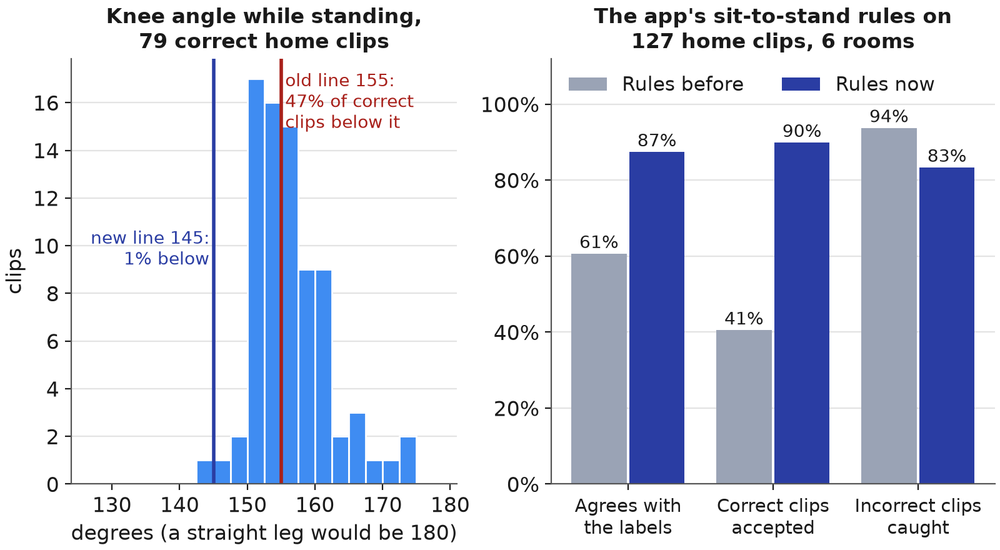

# Sit-to-stand on real home video

Until 19 November 2026 sit-to-stand was the one camera exercise with no camera evidence at all: its only labelled data was lab motion capture (UI-PRMD). This page is the first test on ordinary video, and it changed the app.



## The data

**WLU Rehabilitation Posture** (Wilfrid Laurier University, on Kaggle, MIT licence): short videos of rehabilitation exercises filmed in people's homes on phones and webcams, front and side views, 480p to 1080p, faces pixelated. The folder names are the labels: `Sit To Stand Correct` (79 clips) and `Sit To Stand Incorrect` (48 clips), 2 to 11 seconds each.

Two things to know before reading any number:

- **The labels mean "a valid repetition or not".** The dataset was made for exercise verification. Most incorrect clips are unfinished movements (the person stays on the chair, rises halfway, or never sits down), not small technique mistakes.
- **Nobody is named.** We grouped the clips by room and camera position (clustering the first frame, then checking contact sheets by eye) into **6 recording set-ups** of 27, 22, 32, 18, 21 and 7 clips. Where two rooms looked like the same person we merged them, which can only make the test stricter.

Its "Arm Raise" folder is both arms overhead, a different movement from our one-arm raise to the side, so we did not use it.

## Test 1: the app's rules

A sit-to-stand in the app passes when a complete repetition is found and no rule objects (knees caving in, not standing up tall, sitting down too fast, too fast overall). We ran exactly those rules on every clip. Half of the clips start on the chair (sit, stand, sit) instead of standing; both orders count as one cycle here and the rules read the same angles and times.

| | Agrees with the labels | Macro F1 | Correct clips accepted | Incorrect clips caught |
|---|---|---|---|---|
| Rules before | 61% | 0.60 | 41% (32 of 79) | 94% (45 of 48) |
| **Rules now** | **87%** | **0.87** | **90% (71 of 79)** | **83% (40 of 48)** |
| Settings picked without the tested set-up | 89% | 0.88 | 91% | 85% |

The last row is the honest check on the middle one: each set-up is hidden in turn, the best settings are chosen on the other five and scored on the hidden one. It lands in the same place, so the improvement is not an accident of tuning on the test clips.

### What was wrong

1. **"Stand up tall" fired on people who were standing.** The rule objected when the knee measured under 155 degrees at the top. A single camera does not see a straight leg as 180: across the 79 correct clips the standing knee has a median of 155 and a 10th percentile of 151. So the rule objected to 47% of correct clips. The same line objected to 17% of correct phone squats (REHAB26, 828 repetitions) and 7% on a fixed camera (REHAB24-6, 268). **The line is now 145 degrees**, which objects to 1% of correct sit-to-stand clips and 4% and 0% of correct squats.
2. **"Knees out" fired on side views.** The rule compares knee distance with ankle distance left to right. Side on, both are close to zero and the ratio is noise: on phone squats filmed from the side it objected to up to half of the correct repetitions (REHAB26: 38% at 80 degrees, 52% at 90). **It is now judged only when the person faces the camera** (the shoulder line's sideways share is at least 0.6, which holds up to about 60 degrees to the side). In the front it works as before.

Both fixes are in `web/src/lib/pose/exercises.ts` (`UPRIGHT_KNEE`, `FACING_MIN`) and covered by unit tests.

### What is still wrong

- 8 incorrect clips pass. They contain a complete repetition with a mistake our rules do not look for.
- 8 correct clips are refused: 4 "knees out" (all front views), 3 "sit down slowly", 1 "stand up tall".
- Accuracy per set-up: 0.89, 1.00, 0.94, 0.78, 0.67, 1.00. The weakest is the room where most incorrect clips do complete the movement.

## Test 2: the trained models

Cut the way the app cuts them, the clips that start standing give 50 repetitions (42 from correct clips, 8 from incorrect ones).

| Model | AUC | Correct repetitions flagged | Score shown for a typical correct repetition |
|---|---|---|---|
| Squat model, used as the stand-in for sit-to-stand in the app | 0.84 | 0% | 85 out of 100 |
| Motion-capture sit-to-stand model (UI-PRMD) | 0.54 | 95% | 0 out of 100 |
| The same, put on the camera's scale using the other set-ups | 0.68 | 48% | |

The model trained on motion capture scores 0.91 in the lab and is useless on a camera. The squat model, which has never seen a sit-to-stand, behaves sensibly on them. So the app keeps the squat model for the quality score and the rules for the verdict. With only 8 incorrect repetitions the AUC is a rough number.

## What this does and does not show

- It shows that the app's sit-to-stand check agrees with human labels on 87% of 127 ordinary home videos from 6 rooms, and that before this test it did not (61%).
- It does not show that the app can tell a subtle technique mistake in sit-to-stand: the dataset has few of those.
- The rule changes were chosen with these clips in view. The held-out row above is the guard against fooling ourselves, and our own team clips (docs/RECORDING.md) will be the next independent test.
- Two clips in the dataset are exact copies of two others. They sit in the same set-up, so they never cross between choosing and testing.

## Reproduce

Download the dataset from Kaggle (871 MB, a free account is needed) to `~/jhealth-cache/datasets/wlu_rehab/wlu_rehab.zip`, then in `ml/`:

```
python -I wlu_sit_to_stand.py track      # pose-track the 127 clips, about 12 minutes on a laptop
python -I wlu_sit_to_stand.py rules      # the tables above
python -I wlu_sit_to_stand.py models     # the model table
python -I wlu_sit_to_stand.py chart      # the figure
```

`ml/wlu_groups.json` holds the six set-ups. Dataset: https://www.kaggle.com/datasets/sulaimanmuhammed/wlu-rehabilitation-posture
