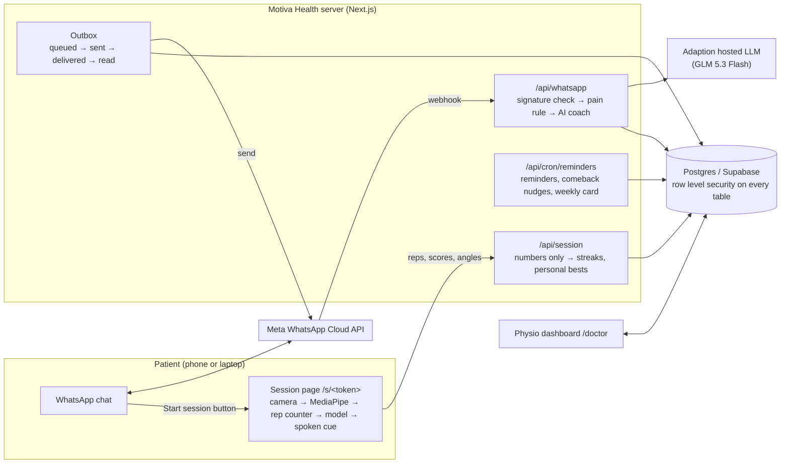

# Motiva Health system design

One page for the pitch and for anyone joining the team. Plain-words history: `docs/HOW_WE_BUILT_IT.md`. How to run things: `README.md`.

## 1. The idea in one breath

The physiotherapist prescribes; WhatsApp brings the patient back every day; the patient's own phone camera checks every repetition (the video never leaves the phone); the physiotherapist sees who is improving, who is stalling and who is in pain, without chasing anyone.

## 2. The parts

| Part | What it does | Where |
|---|---|---|
| WhatsApp coach | Welcome, plan with a Start button, answers every message, reminders, celebrations | `web/src/lib/whatsapp/`, `web/src/lib/coach/`, `web/src/lib/reminders.ts` |
| Pain rule | Pain 7/10+, chest pain, a swollen calf, a fall: fixed safety reply (Health811 / 911) and an alert. Plain code, runs before any AI | `web/src/lib/safety.ts` |
| AI coach | Writes the reply in a fixed JSON shape; code checks it (no medicine, no plan changes, no Start button while a pain alert is open, pain facts never overwritten); a failure sends a safe fallback | `web/src/lib/coach/` |
| Session page | Camera, MediaPipe heavy pose model in the browser, rep counter, four exercise profiles, model score, rule cues, spoken feedback | `web/src/app/s/[token]/`, `web/src/lib/pose/` |
| Models | One JSON file per exercise, trained in Python, run in the browser; the browser is tested to give Python's exact score | `ml/`, `web/public/models/` |
| Dashboard | Patients by status (needs review, stalling, inactive, new, on track), adherence, range of motion trends, alerts, coach memory, chat | `web/src/app/doctor/` |
| Database | Patients, plans, sessions, reps, messages (outbox), memories, alerts; every rule enforced by the database; 41 automatic checks | `supabase/migrations/` |
| Engagement | Streaks, milestones, personal bests, daily reminder with the patient's own goal, comeback nudge after 3 days, weekly card | `web/src/lib/engagement.ts` |

## 3. Three layers of judgement, from most to least trusted

1. **Fixed rules** decide anything about safety (pain, red flags, exercise on hold) and name the visible mistakes (knees caving in, bent elbow, not straight, too fast). Every rule is unit-tested.
2. **The trained model** gives each rep a quality score, and flags a rep on its own only when it is confident: at the chosen cut-off about 9 in 10 of its flags are real mistakes (squat: precision 0.90; arm raise: 0.92), measured on people it never saw.
3. **The language model** only writes words. It cannot skip the pain rule, remove an alert, change a plan, give medicine advice or hand out a Start button during a pain hold; code checks every answer before it is sent, and the physiotherapist sees every message.

## 4. A day in the loop

1. 5 pm (the patient's chosen hour): "Hi Maria! Time for today's 3 short exercises. You're on a 4-day streak. Every session brings you closer to walking the dog around the block. Tap Start when you're ready." [Start session]
2. Maria taps Start. The page counts her sit-to-stands out loud, says "Sit down slowly, with control" once, and scores each rep.
3. Only numbers go to the server. WhatsApp: "Well done, Maria! Sit-to-stand: 20 reps, average quality 82/100, deepest knee bend 96° (last time 93°). New personal best: 96°! Tip for next time: ..."
4. Maria writes "can I do 3 sets tomorrow?" The coach praises her energy, says the physio decides, and flags it on the dashboard.
5. The physio's dashboard shows Maria on track, knee bend trending up, one coach note to review.

## 5. Privacy and safety by design

- Video never leaves the patient's device; the server receives counts, scores and angles.
- The patient's link is a 64-character random token; there is no password for a patient to forget.
- The dashboard needs a password and refuses to open through a tunnel or on a deployed server without one.
- Every WhatsApp webhook must carry Meta's signature (when the app secret is set); duplicates are stored once.
- Row level security is on for every table; only the server can read or write.
- Patient messages go to Adaption only to write a reply; the demo uses simulated patients and the team.

## 6. Accuracy, honestly

Macro F1 on people the model never saw (1.0 perfect; always saying "correct" ≈ 0.35):

| Exercise | Lab body tracking | Camera (what the app sees) | When the app flags a rep |
|---|---|---|---|
| Chair squat | 0.83 | 0.79 on two camera datasets | right 90% of the time |
| Sit-to-stand | 0.90 | no public camera data; squat model as a labelled stand-in | rules |
| Arm raise to the side | 0.97 (0.82 on stroke patients) | 0.66 | right 92% of the time |
| Seated knee extension | no public data | rules (straightness, 2-second hold, leaning back) | rules |

The route to higher camera accuracy is the team's own clips in the demo setup (`docs/RECORDING.md`), measured on a teammate the model never saw.

## 7. Running it

| Where | Database | WhatsApp | Notes |
|---|---|---|---|
| Laptop (today) | PGlite (Postgres inside the app) | Meta test number through a free Cloudflare tunnel | The tunnel address changes on every restart; Meta's webhook must be updated |
| Demo day (recommended) | Supabase (free plan) | Same Meta app, webhook on a fixed Vercel address | Vercel free plan: one reminder run per day (cron), hourly needs a paid plan |
| Product | Supabase / managed Postgres in Canada | Verified business, own number, approved reminder templates | Clinical review of all wording, consented data, a privacy review |

## 8. What scaling would change

- Reminders outside the 24-hour window need approved WhatsApp templates (Meta charges per template message).
- Per-clinic dashboards: the schema already links every patient to a doctor; add clinics and logins (Supabase Auth).
- A model per clinic population: retrain from consented session data with the same scripts; the honest test is unchanged.

## 9. How Motiva Health compares (public sources, 19 November 2026)

| | No app install | Camera rep scoring | Extra hardware | Patient's own physio | Chat | WhatsApp |
|---|---|---|---|---|---|---|
| Sword (bought Kaia, 2026) | no | yes | pad / trackers | no (Sword's physios) | human + AI | no |
| Hinge Health | no | yes (TrueMotion) | kit, optional TENS | no (Hinge's physios) | human + AI (Robin) | no |
| Kemtai | yes (browser) | yes | no | yes | ? | no |
| Exer Health | no | yes | no | yes | ? | no |
| Physitrack / PhysiApp | no | no (self-report; camera "coming") | no | yes | human | no |
| Medbridge | no | assessments only | no | yes | ? | SMS reminders |
| Limber | no | no (self-report) | no | yes | staff | ? |
| Phio (NHS) | no | no (self-report) | no | NHS clinician | triage bot + clinician | no |
| **Motiva Health** | **yes** | **yes** | **no** | **yes** | **AI, every message visible to the physio** | **yes** |

What we can honestly claim in the pitch:
1. Nothing to install: it lives in WhatsApp, which older patients already use.
2. The patient's own physiotherapist prescribes and sees everything; we found no product combining own physio, camera-scored reps and chat.
3. Adherence is counted by the camera, not self-reported (nearly all published adherence evidence is self-report).
4. The pain rule is plain, auditable code that runs before any AI, and the AI cannot clear an alert.
5. Video never leaves the device, and every fact the coach remembers links to the message it came from.

Evidence on reminders: text reminders raise home-exercise adherence modestly in trials (ADHERE, knee osteoarthritis, n=110: 1.8 vs 1.3 exercise days a week; Rush knee/hip replacement text bot, n=159: 46 vs 38 minutes a day), with little proof on pain or function, and all of it self-reported.
